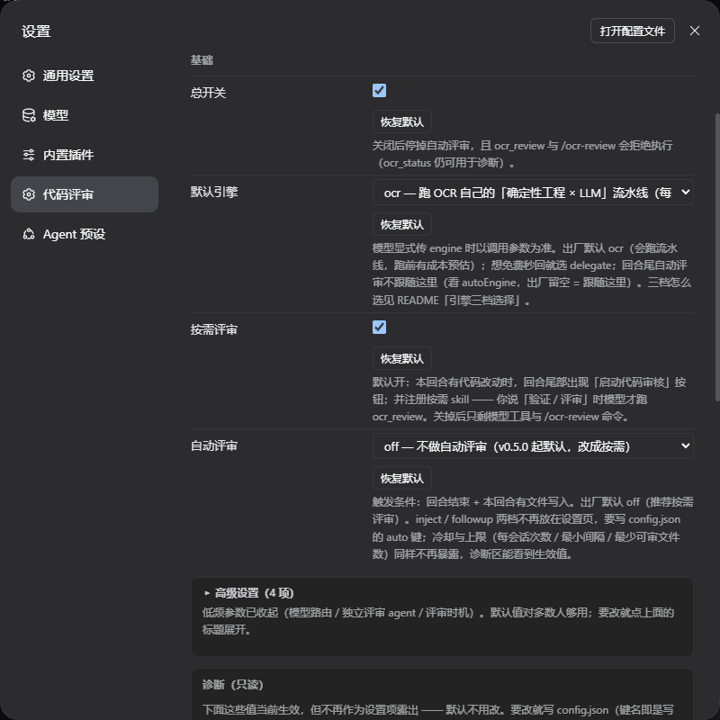
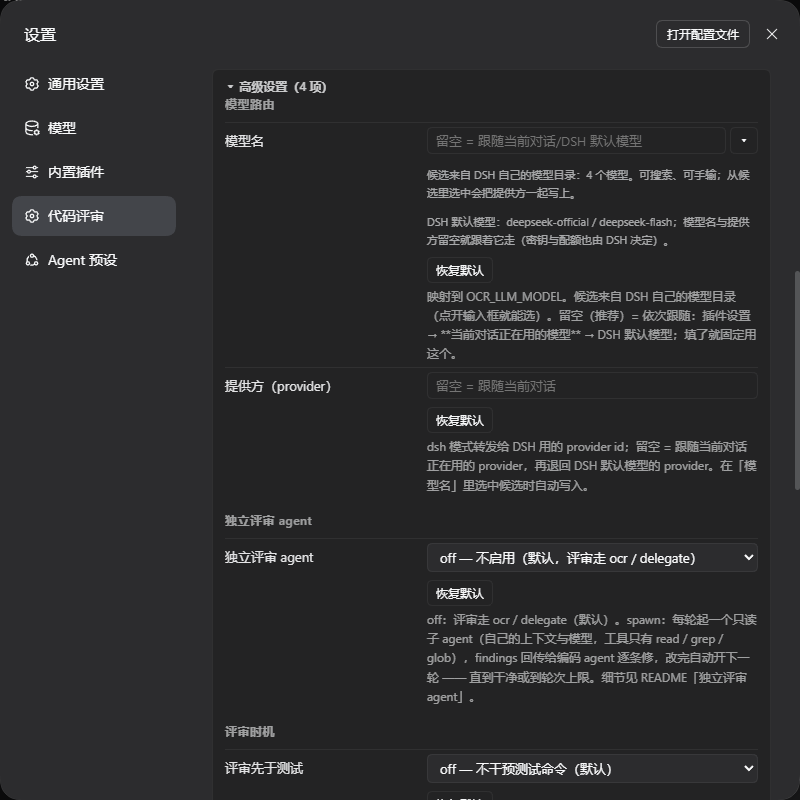

[English](README.md) · [中文](README.zh.md)

# dsh-open-code-review

[](https://github.com/xinyangGL/dsh-open-code-review/actions/workflows/ci.yml)

Code review for DSH (DeepSeek Harness), powered by Alibaba **OpenCodeReview** (`ocr`).

**The four lines you actually need:**

- **What it is** — a code review that the model can run on demand: the review spec (rules + file list + unified diff) comes from `ocr`, findings come back per file as `path:line [severity] message`, and you can also let it run automatically or gate the test command behind it.
- **What it does not do** — it does not install `ocr` for you, it does not run your tests, it does not send anything anywhere except the LLM you configured, and it does not replace CI: one full-file scan measured **176–600 s per file** and about **$0.16**.
- **What it costs** — the default engine has been `ocr` since 0.10.0, so a review *does* call an LLM and is billed by tokens; what you get in exchange is a **cost estimate before the run** (how many files are reviewable, roughly how many minutes) so the decision is yours. Set `engine = delegate` to spend nothing: the current session reviews against the ocr-parsed rules and answers in seconds.
- **What you need** — Node ≥ 20, the `ocr` CLI (on Windows a real `.exe`, not a `.cmd` shim), DSH with the plugin installed, and a model (with `llmMode = dsh` DSH’s own model is enough — nothing to fill in).

The plugin registers two model tools — `ocr_review` (run a review) and `ocr_status` (diagnostics) — plus the `/ocr-review` command, and it can review **automatically** at the end of a turn that wrote files. The review spec (rules + file list + unified diff) always comes from `ocr`; what changes is **who executes it**:

- `delegate` — **the default engine in 0.8.0–0.9.x, an explicit choice since 0.10.0**: the plugin hands the current model the ocr-parsed rules + file list + diff, and the model reviews against those rules (no LLM call inside ocr, no extra token cost, seconds instead of minutes — but also no LLM post-filter, and coverage depends on the receipt rules being followed);
- `ocr` — ocr's own LLM pipeline (with `llm.mode = dsh`, DSH lends it the models, keys and quota); on real projects this measured **176–600 s per file** and is billed by tokens;
- `auto` — try `ocr`, fall back to `delegate` when ocr has no LLM endpoint. That silent fallback is exactly why it is **not** the factory default: “reviewed” and “handed a half-result” would look identical. It stays an explicit choice;
- `reviewer.agent = spawn` — each round spawns an **independent read-only reviewer subagent** (its own context and model, only `read` / `grep` / `glob`); it returns structured findings, the coding agent fixes them or explains why not, and the next round starts automatically.

## Quick start (5 minutes)

For a machine that has never had `ocr` installed. Budget: ~1 min Node, ~2 min `ocr`, ~1 min install + verify, ~1 min for the first review.

| Step | Do | You are done when |
| --- | --- | --- |
| 1 | `node -v` → need ≥ 20 | it prints `v20.x` / `v22.x` / `v24.x` |
| 2 | `npm i -g @alibaba-group/open-code-review` | `opencodereview --version` prints a version |
| 3 | Give `ocr` a model. With `llmMode = dsh` (the default) there is **nothing to fill in** — DSH lends it its model, key and quota. Otherwise pick `endpoint` and set `llmBaseUrl` + `llmApiKeyRef` (the *name* of a DSH credential). | `ocr_status` shows an LLM route and does **not** say `no valid LLM endpoint configured` |
| 4 | `dsh plugin --profile <profile> add github:xinyangGL/dsh-open-code-review`, then restart DSH | `ocr_status` reports the executable + version, the LLM route and where the config came from |
| 5 | `/ocr-review` — or click **Start code review** at the end of a turn that wrote files | findings, or an explicit “no issues” |

**Read this before you start** (the honest limits):

- `ocr` is an **external prerequisite** the plugin cannot install for you, and *every* code path shells out to that binary — including `delegate`, which only skips the LLM call *inside* `ocr`. “The plugin has no runtime dependencies” means npm packages, **not** the CLI.
- On Windows point `ocrPath` at the native `opencodereview.exe`. `.cmd` / `.bat` / `.ps1` shims fail with `EINVAL`, because the host spawns without a shell.
- `engine = ocr` (the default since 0.10.0) and `auto` run OCR's own pipeline: **176–600 s per file**, billed by tokens (≈ $0.16 for one scanned file), with a cost estimate given before the run. Do not wire those two into CI as-is. `engine = delegate` spends no review tokens and returns the spec in seconds — the trade-off is no LLM post-filter, so coverage rests on the receipt.
- `ocr_status` prints platform-specific install steps when it prints `OCR_NOT_FOUND` — follow those instead of guessing.

### What it promises (four claims, each one checkable)

The value here is not that the reviewer is smarter; it is that **you know where the conclusion stops**:

| Promise | How to check it |
| --- | --- |
| Three timings (on demand, the turn-tail button / `/ocr-review`, automatic) and three engines, with the source of the conclusion and its cost in the open | `ocr_status`: `engine` / `engineSource` / `stats.byEntry` / `llm` |
| **It never fakes “nothing found”**: only exit code 0 **plus** an empty findings collection counts as clean; unparsable output, unknown field names, a truncated budget or an unfinished run produce `ok: false` or `partial` | codes `OCR_OUTPUT_UNPARSABLE` / `OCR_OUTPUT_SHAPE_UNKNOWN` / `OCR_LLM_MISSING` / `OCR_TIMEOUT` / `OCR_ABORTED`, plus the `partial` / `partialReasons` / `coverage` fields |
| Coverage is auditable: a `delegate` spec arrives in slices with a coverage-receipt rule, and the slice/drop counts are reported; on the `ocr` side only the partial-result signals it states explicitly are trusted | the `[片 i/n · path · 本文件 hunk a-b/c · bytes]` headers and `coverage.{totalFiles,totalHunks,keptHunks,droppedHunks,slices,truncated,partial}` |
| You see the price before paying: an `ocr` run names this run's scale and time order in its first note, and the choice stays yours | first note: `本次实测可审 N 个文件（另排除 M 个） → 按真机历史约 lo~hi 分钟`; when the probe fails only that sentence is missing |

**Not promised** (saying any of these would be over-claiming): more accurate, stronger, finds every bug, CI-grade, security audit, whole-repo scan. The three engines are not capability tiers; they are a switch of **cost and of who is responsible**: `ocr` hands coverage and false-positive convergence to the pipeline, `delegate` hands them to the current session's model, and the third hands them to a read-only reviewer with its own context.

### What the first click looks like

Five things a newcomer can see in the first minute (as of 0.12.0):

1. **The button only appears when the turn actually changed something** — no file writes, no button. If the host does not expose a "this turn changed files" signal, it falls back to always showing: better a button you did not need than a plugin pretending it knows.
2. **Before you click, the button's sub-line states the cost** — per current engine: `ocr` → "runs the OCR pipeline, billed by tokens, minutes per file"; `delegate` → "no LLM call, spec in seconds". That is an order-of-magnitude warning, not a quote (the quote is in the first note after the run starts).
3. **Clicking posts an instruction into the session** (it is not a black-box call): the model runs `ocr_status` to check the wiring, then `ocr_review`. A "review progress" line shows up in the conversation (stage + elapsed), and the same job appears in the Jobs panel.
4. **The conclusion always has six layers**: verdict line / cost and scale of this run / findings (`[高] [中] [低] [未分级]` bands with group counts) / next step / provenance / appendix (review spec, notes, truncated output, raw JSON — this layer **always** exists).
5. **A run that did not finish never says "no issues"**: failures give a stable code plus a next step; incomplete coverage gives `⚠️ partial conclusion` plus a coverage receipt (how many hunks kept, how many dropped, which slice was truncated).

## Requirements

| What | Detail |
| --- | --- |
| DSH host | The plugin is loaded by `dsh plugin ... add` (or from the plugin manager in the GUI) and runs inside the host process. |
| Node.js ≥ 20 | `package.json` `engines`; CI exercises 20 / 22 / 24 on Ubuntu and Windows. |
| Alibaba `ocr` CLI | `npm i -g @alibaba-group/open-code-review`. It is an **external prerequisite** — the plugin cannot install it for you. The plugin itself has no npm runtime dependencies, but every path through it (including `engine: "delegate"`) runs the `ocr` binary. |
| Windows: a real `opencodereview.exe` | Point `ocrPath` at the native executable, e.g. Volta `%LOCALAPPDATA%\Volta\tools\image\node\<version>\node_modules\@alibaba-group\open-code-review\node_modules\@alibaba-group\ocr-win32-x64\bin\opencodereview.exe`, or the global npm location `%APPDATA%\npm\node_modules\...`. **Never** `.cmd` / `.bat` / `.ps1`: those are script shims, and the host spawns without `cmd.exe`, which fails with `EINVAL`. |
| macOS / Linux | Point `ocrPath` at the real path from `which opencodereview` (not at a wrapper script). |
| Or no config at all | Leave `ocrPath` empty and put `opencodereview` on `PATH`, or set `OCR_EXECUTABLE` / `OPENCODEREVIEW_BIN`. |

Executable lookup order (`lib/ocr-cli.js`): `ocrPath` → `ocrCandidates` → `OCR_EXECUTABLE` → `OPENCODEREVIEW_BIN` → well-known Volta / global-npm locations (native `.exe` first) → `PATH` (`opencodereview`, `opencodereview.exe`). Script shims are rejected with the reason spelled out.

## Install

```powershell
dsh plugin --profile <profile> add github:xinyangGL/dsh-open-code-review
# the https form is equivalent
dsh plugin --profile <profile> add https://github.com/xinyangGL/dsh-open-code-review
```

Restart the DSH host afterwards, then verify:

```
ocr_status
```

It reports the resolved executable and its version, the LLM route in force, and where the configuration came from (`configSource` / `configPath`). When `ocr` cannot be found it prints platform-specific install steps (global npm install, Node ≥ 20, and the Windows “real `.exe`, not the shim” warning) — you do not need this README for that.

## Changing config / taking effect

| What you changed | How it takes effect |
| --- | --- |
| Any field in the settings page | **Immediately.** The host writes the value into the current profile’s patch YAML and broadcasts it; the plugin re-reads the config — no restart. |
| An external config file | **Immediately.** Re-read by mtime. |
| `lib/*.js` (host side) | Restart the DSH host (ESM module cache). |
| `lib/client.js`, or `dsh.client` in `package.json` | Restart the host **and** reload the page (the client bundle is built and served by the host). |
| `cordis.patch.yml` / `package.json` | Re-run `dsh plugin --profile <profile> add ...` (or disable → enable it in the plugin manager), then restart. |

## Configuration

### Settings page

Two entries lead to the same form:

- **Settings → Code review** — the plugin’s own settings page (the nav title is 「代码评审」).
- **Settings → Plugins → dsh-open-code-review** — the plugin card shows a **read-only summary** plus a pointer to the settings page; values are edited on the settings page, not on the card.

Layout of the page:

- **First screen — 4 rows**, expanded: `enabled` (master switch), `engine`, `onDemand`, `autoReview` (this one offers only `off` and `adaptive`; the other two modes stay file-only).
- **Dependent rows** appear with their parent: `reviewerProvider` / `reviewerModel` / `reviewerRounds` when `reviewerAgent = spawn`.
- **「Advanced settings」— 4 items, folded by default**: *model routing* (`llmModel`, plus `llmProvider` in `dsh` mode), *independent review agent* (`reviewerAgent`), *review before tests* (`preTest`). With `reviewerAgent = spawn` the section holds 7 rows. The fold title reads 「高级设置（4 项）」; if it holds edited-but-unsaved rows it also shows 「N 项待保存」.
- **Read-only diagnostics block** at the end: the 15 keys that now live in `config.json` only (`llm.mode`, `llm.baseUrl`, `llm.protocol`, `llm.apiKeyRef`, `autoScope`, `autoMaxPerSession`, `autoMinReviewableFiles`, `autoMinIntervalMs`, `autoSkipSubagents`, `autoIncludeDiff`, `audience`, `ocrPath`, `timeoutMinutes`, `progress`, `verbose`) are listed as `current value · key name`. Runtime facts (bridge address, per-entry counters, resolved route) come from `ocr_status`, not from the browser side.
- Rows the settings page has touched carry a 「设置页已改」 badge.
- Values are stored per profile (they do not follow you to another profile or machine). `ocr_status` shows where each key actually came from.





*Real screenshots (DSH on Windows, sidebar cropped out) **from the 0.10.0 layout**: the basics group and the expanded advanced section. Since 0.11.0 the first screen holds four rows and the advanced section holds the three groups described above.*

### Config sources

`resolveConfigFile()` (`lib/config.js`) reads **one** file — the first that exists:

1. the path in `DSH_OPEN_CODE_REVIEW_CONFIG`;
2. `<DSH_HOME>/dsh-open-code-review.json` — **recommended** (`DSH_HOME` defaults to `~/.dsh`);
3. `<plugin dir>/config.json` — only meaningful for a source / local checkout: a GitHub (git) install lives under `node_modules` and is overwritten on upgrade.

That file layer holds the keys the settings page does not have (`ocrCandidates`, `extraArgs`, `env`, `llm.apiKey`, a larger `maxTimeoutMinutes`, …). Precedence is **settings page > config file > factory defaults**, and `ocr_status.fileValues` lists the keys the file actually provided.

`ocr`’s own configuration (`~/.opencodereview/config.json`) is separate; `ocr_status.ocrHomeConfig` reports what was found there.

### Key reference

`Where` says which settings-page row exposes the key (or `file only`). Defaults are the factory values in `lib/config.js`.

**Since 0.11.0 the settings page renders three kinds of controls**: four first-screen fields (`enabled` / `engine` / `onDemand` / automatic review, and automatic review offers only `off` and `adaptive`), a collapsed **Advanced** section with three groups (model routing / independent review agent (its three fields only when `reviewer.agent = spawn`) / review before tests), and a **read-only diagnostics block** at the end. The keys that are not in those three places (`llm.mode`, `llm.baseUrl`, `llm.protocol`, `llm.apiKeyRef`, `autoScope`, `autoMaxPerSession`, `autoMinReviewableFiles`, `autoMinIntervalMs`, `autoSkipSubagents`, `autoIncludeDiff`, `audience`, `ocrPath`, `timeoutMinutes`, `progress`, `verbose` — 15 of them) **are still fully supported**: the schema and the `config.json` contract are untouched, they just have no input control any more, and the diagnostics block lists each one as `current value · key name` so you know what to write in `config.json`. Runtime facts (bridge address, per-entry counters, resolved route) live in `ocr_status`.

| Key | Default | Where | Notes |
| --- | --- | --- | --- |
| `enabled` | `true` | First screen | Master switch. `false` stops automatic review and makes `ocr_review` / `/ocr-review` refuse to run (`ocr_status` still works). |
| `engine` | `"ocr"` | First screen | Default engine: `ocr` (**the factory default since 0.10.0**: runs the real pipeline, billed by tokens, and prints a cost estimate first) / `delegate` (no LLM, seconds) / `auto` (falls back silently when no LLM is configured, hence not the default). A tool call can override it. |
| `auto` | `"off"` | First screen (`autoReview`, only `off` / `adaptive`) | Settings-page key `autoReview` writes here. `off` (the default since 0.5.0) / `adaptive` / `inject` / `followup`; the last two are file-only since 0.11.0. |
| `onDemand` | `true` | First screen (`onDemand`) | On-demand review: **since 0.11.0 the Start code review button only appears when this turn actually changed something** (it reads the host’s `api/changes.summary`; anything it cannot read means “show it anyway”, so a changed turn can never go unnoticed), plus the runtime skill `ocr-on-demand-review`. |
| `reviewer.agent` | `"off"` | Advanced · independent review agent (`reviewerAgent`) | `off` / `spawn` — run reviews through an independent read-only reviewer subagent. |
| `llm.mode` | `"dsh"` | file only (listed in diagnostics) | `dsh` / `endpoint` — see [LLM routing](#llm-routing). Since 0.11.0 there is no settings-page control; the `dsh` bridge is the supported path, and `endpoint` stays available in the config file as the explicit escape hatch. |
| `llm.model` | `""` | Advanced · model routing (`llmModel`) | → `OCR_LLM_MODEL`; empty = follow the model this conversation is using, then DSH’s global default. |
| `reviewer.provider` | `"spawn"` | dependent (`spawn`) | Subagent provider. A wrong name fails with `OCR_REVIEWER_UNAVAILABLE` and lists the available ones. |
| `reviewer.model` | `""` | dependent (`spawn`) | Empty = that provider’s default model. |
| `reviewer.rounds` | `3` | dependent (`spawn`) | 1–10 round trips before automatic re-review stops. |
| `llm.baseUrl` | `"https://api.commandcode.ai/provider/v1"` | file only (listed in diagnostics) | → `OCR_LLM_URL`; only used when `llm.mode = endpoint`. |
| `llm.protocol` | `"openai"` | file only (listed in diagnostics) | `openai` / `anthropic` → `OCR_LLM_PROTOCOL`; only used when `llm.mode = endpoint`. |
| `llm.apiKeyRef` | `"COMMANDCODE_API_KEY"` | file only (listed in diagnostics) | → `OCR_LLM_TOKEN`, resolved from the DSH credential store (no plaintext on disk); only used when `llm.mode = endpoint`. |
| `autoScope` | `"workspace"` | file only (listed in diagnostics) | Scope used by automatic reviews: `workspace` / `range` / `commit` / `scan`. |
| `autoMaxPerSession` | `3` | file only (listed in diagnostics) | Max automatic reviews per session (`0` = none; manual reviews still work). |
| `autoMinReviewableFiles` | `1` | file only (listed in diagnostics) | Skip the automatic review when fewer files are reviewable. |
| `autoMinIntervalMs` | `60000` | file only (listed in diagnostics) | Cooldown between two automatic reviews, in ms. |
| `autoSkipSubagents` | `true` | file only (listed in diagnostics) | Turns of subagents (`delegationDepth > 0`) do not trigger automatic review. |
| `autoIncludeDiff` | `true` | file only (listed in diagnostics) | Include the unified diff when an automatic review falls back to `delegate`. |
| `preTest` | `"off"` | Advanced · review before tests | Review before tests: `off` / `remind` / `gate` — see [Review before tests](#review-before-tests-pretest-since-057). |
| `audience` | `"agent"` | file only (listed in diagnostics) | → `ocr --audience`; `agent` = summary only, `human` = the fuller report. |
| `ocrPath` | `""` | file only (listed in diagnostics) | Absolute path to the real `ocr` executable; empty = auto-discovery. |
| `timeoutMinutes` | `15` | file only (listed in diagnostics) | → `ocr --timeout` and the plugin-side hard timeout; larger values go to `maxTimeoutMinutes` in the file layer. |
| `progress` | `true` | file only (listed in diagnostics) | Register each review as a background job (Jobs panel) and show the in-session progress row. |
| `llm.provider` | `""` | Advanced · model routing (`dsh`) | Provider id the bridge forwards to; empty = follow the model **this conversation** is using, then DSH’s global default. |
| `verbose` | `false` | file only (listed in diagnostics) | Log the ocr command line, env and timings to the DSH log. |
| `autoEngine` | `""` | file only | Engine used by automatic reviews; empty = follow `engine`. |
| `ocrCandidates` | `[]` | file only | Extra candidate paths tried after `ocrPath` (`[]` clears the layer). |
| `extraArgs` | `[]` | file only | Raw extra arguments appended to the ocr command line. |
| `env` | `{}` | file only | Extra environment variables for the ocr child process (`""` deletes one). |
| `includeDiffMaxBytes` | `120000` | file only | Cap (characters) on the diff embedded in the generated spec. |
| `llm.bridgePort` | `18800` | file only (**new in 0.11.0**) | Preferred port for the local `dsh` bridge: fixing it keeps the address stable across restarts; if it is taken the bridge walks forward (up to 10 ports) and `ocr_status.bridge.requestedPort` / `portShifted` report what it actually got. **Deliberately not a settings-page control** (there is normally no reason to change it). |
| `llm.effort` | `""` | file only (**new in 0.11.1**) | Model thinking effort: the local `dsh` bridge forwards it as DSH's `GenerateOptions.reasoningEffort` to the model this conversation is using; empty = unspecified (whatever DSH / the model declares as its default). Valid ids are declared **per model** (the catalog's `reasoning.efforts`), so the plugin does not validate: a wrong value is rejected by DSH *before* any upstream call and the error is reported verbatim (no silent degradation). Read on every request — no restart. **Not the same thing as `ocr_review({ effort })`**, which is ocr's own review effort. |
| `maxIssuesInText` | `40` | file only | Max issues listed in the text summary (the full data stays in `issues` / `rawJson`). |
| `maxTimeoutMinutes` | `60` | file only | Hard upper bound for `timeoutMinutes`; itself clamped to 24 h (1440 min) in code. |
| `llm.apiKey` | `""` | file only | Literal key for the `endpoint` route. Prefer `llm.apiKeyRef`: a literal ends up on disk in a config file — and keep that file out of any repository (this repo ships only `config.example.json`). |
| `reviewer.persona` | `""` | file only | Extra persona / instructions for the reviewer subagent. |

### Choosing an engine

The spec always comes from `ocr`, so all three engines review against the same rules; you can switch per call.

| Engine | What actually runs | Cost | Pick it when |
| --- | --- | --- | --- |
| `ocr` | ocr’s own pipeline: deterministic engineering + its LLM reviewer, parsed back into `issues` | Needs an LLM for ocr — with `llm.mode = dsh` that is DSH’s model, key and quota | You want OCR’s own review pipeline and are fine with the cost — 176–600 s per file, billed by tokens. Explicit opt-in since 0.8.0. |
| `delegate` | No LLM call inside ocr: the plugin returns the ocr-parsed rules + file list + unified diff, and **the current model** reviews by those rules | Uses the current session’s model/quota only | The default from 0.8.0 to 0.9.x (in 0.10.0 `ocr` took the default back) — you have no LLM key/quota to spare, or you want the review in seconds rather than minutes. `engine = auto` falls back to this automatically. |
| `reviewer.agent = spawn` | Each round spawns an independent read-only subagent (own context + model, tools limited to `read`/`grep`/`glob`) that returns structured findings; the coding agent fixes them or explains why not, then the next round starts automatically until clean or the round limit | The most expensive, and the closest to a human review | High-risk changes where “the author reviews their own work” is not enough. |

**Which one?** Start with `ocr` (or `delegate` if you want reviews without spending anything extra), and switch on `reviewer.agent = spawn` for the changes that really matter.

### LLM routing

| Mode | Behaviour |
| --- | --- |
| `dsh` (default, recommended) | `ocr` is a separate subprocess and cannot reach cordis, so the plugin starts a small OpenAI-compatible bridge on `127.0.0.1` that accepts only a random per-run token and forwards requests to DSH’s `ctx.llm.stream`. Models, provider, keys, account rotation and quota stay inside DSH — nothing to configure. The bridge port is **fixed since 0.11.0** (`llm.bridgePort`, default `18800`) so the address survives a restart; if it is taken the bridge walks forward (up to 10 ports) and `ocr_status.bridge` reports the real one via `requestedPort` / `portShifted`. The model is resolved as **plugin settings → the model this conversation is using (`Session.requestContext()`) → the DSH global default**, so switching models mid-conversation is enough — no restart, no new switch. |
| `endpoint` | ocr talks straight to a static endpoint: `llm.baseUrl` + `llm.protocol` (`openai` / `anthropic`) + a key — `llm.apiKeyRef` names a DSH credential (recommended), or `llm.apiKey` holds a literal key in the config file. |

The plugin maps these onto the environment ocr understands: `OCR_LLM_URL`, `OCR_LLM_PROTOCOL`, `OCR_LLM_TOKEN`, `OCR_LLM_MODEL` (`config.env` can override or add more).

`ocr_status.bridge` shows the `dsh` bridge live: `url`, the masked `token`, `requestedPort` + `portShifted` (0.11.0: the preferred port and whether it was taken), `requests`, `failed`, `rejected` + `lastReject` (since 0.6.1: requests that reached the bridge but were never forwarded — bad token, invalid body, empty `messages`, missing route — counted separately so `failed` only means "forwarded upstream and failed"), `retries`, `retrySkips` + `retrySkipReason` (why a request was not retried automatically; cleared at the start of every forwarded request since 0.6.1 so one request's reason never leaks into another's diagnostics), cumulative `tokens` (`prompt_tokens`, `completion_tokens`, `total_tokens`, `cache_read_tokens`, `cache_write_tokens`, `partial`), `lastError`, `lastProvider`, `lastModel`, `inflight` and `uptimeMs`. **Since 0.11.0 the `dsh` route no longer falls back to the static endpoint**: if the host has no `llm` service, the bridge fails to start, or no model can be resolved, `ocr_review` fails with `OCR_LLM_MISSING` and does not spawn a single subprocess (no conclusion, and nothing billed), with a `nextStep` per cause. Setting `llm.mode = endpoint` in `config.json` remains the explicit escape hatch.

## Usage

### Tool `ocr_review`

| Parameter | Type | Meaning |
| --- | --- | --- |
| `scope` | `workspace` \| `range` \| `commit` \| `scan` | `workspace` (default) = uncommitted changes, equivalent to `ocr review`; `range` uses `from`/`to`; `commit` uses `commit`; `scan` scans `paths` and needs no diff. |
| `from` / `to` | string | Start / end ref of `scope = range`, e.g. `main`, `feature-x` (`to` omitted = up to the working tree). |
| `commit` | string | Commit hash or tag for `scope = commit`. |
| `paths` | string[] | Files/directories to scan for `scope = scan`; also filters the `git diff` in `delegate` mode. |
| `engine` | `delegate` \| `ocr` \| `auto` | Defaults to the configured `engine` (factory default `ocr` since 0.10.0). `auto` = try ocr, fall back to delegate when ocr has no LLM. `ocr` / `auto` cost LLM tokens; `delegate` does not. |
| `reviewer` | boolean | `true` = force the independent reviewer subagent (fails with `OCR_REVIEWER_UNAVAILABLE` instead of falling back); `false` = force `ocr`/`delegate`; omitted = follow `reviewer.agent`. |
| `preview` | boolean | Only list the files that would be reviewed and the exclusions; no LLM call (like `ocr review -p`). |
| `effort` | `low` \| `medium` \| `high` | Review effort preset (ocr’s `--effort`). |
| `model` / `provider` | string | Override the model / provider for this run. |
| `exclude` | string[] | gitignore-style exclusion patterns (joined with commas for `--exclude`). |
| `rulePath` | string | Path to a custom system-rule JSON file (ocr’s `--rule`). |
| `timeoutMinutes` | number | Timeout for this run; defaults to the plugin config. |
| `repo` | string | Git repository root; defaults to the session working directory. |
| `includeDiff` | boolean | `delegate` mode only: embed the unified diff in the spec (default `true`). |
| `extraArgs` | string[] | Raw extra arguments for ocr (advanced). |

Unknown parameters are rejected (`additionalProperties: false`), so a typo fails loudly instead of silently doing nothing.

The result carries: `ok`, `code` (empty on success), `engine` (the one that actually ran: `ocr` / `delegate` / `agent`), `reviewer` (`provider`, `model`, `round`, `rounds`, `childId`, `stopReason`, `verdict` = `clean` / `issues` / `uncertain`), `scope`, `repository`, `command` (the ocr command line that ran), `exitCode`, `durationMs`, `reviewableFiles[]` (`path`, `status`, `insertions`, `deletions`), `excludedFiles[]`, `issues[]` (`file`, `line`, `severity`, `message`), `summary`, `reviewSpec` (the `delegate` payload), `configHint`, `notes[]`, `rawJson` (ocr’s stdout, up to 100 000 characters), `stderr`, `lostOutput`, `spillPath`, `llmMissing`, `usage` (`prompt_tokens`, `completion_tokens`, `total_tokens`, `cache_read_tokens`, `cache_write_tokens`, `partial`, `requests` — accumulated through the bridge on the `dsh` route), `timedOut`, `aborted`, `nextStep` (empty on success; on failure it is the concrete next action for that `code` — the failure text renders it as a `下一步：…` line).

Long reviews no longer look stuck (since 0.8.0): while `ocr` runs, the job progress row gets a heartbeat every 30 s — `ocr 运行中 2m10s · 还没有任何输出（超时 15 分钟；等不及可以改用 engine=delegate，几秒出规格）`, switching to `…最近一次输出在 4.0s 前` once output starts. When a run that would call an LLM starts, the first note is a cost hint: `成本提示：engine=ocr 走 OCR 的 LLM 流水线 —— 真机历史 176~600s/文件、按 tokens 计费（scan 单文件约 $0.16）…想省钱用 engine=delegate`. `delegate` runs get no cost hint, because they cost nothing.

### Tool `ocr_status`

Diagnostics for one call: resolved `executable` + `version`, `configPath` / `configSource` / `fileValues[]`, `installHint`, `settingsPage`, the effective `enabled` / `engine` / `auto` / `llmMode` / `llmRoute` / `llmEndpoint`, the bridge counters (above), `reviewer` availability (`providers[]`, `ready`, `error`), `credentialRef` / `credentialSource`, `ocrHomeConfig`, `llmEnv[]`, a minimal `llmTest`, `hooks` (which event listeners actually registered), `host` (per-capability probe of what this host provides), `preTest`, `stats.byEntry` (per-entry review counts, 0.9.0), and `notes[]`. Start here whenever a review fails.

### Command `/ocr-review`

Runs a review from the input box: it injects a follow-up instruction into the current session, which then calls `ocr_review` (default `scope = workspace`) and works through the findings one by one. It accepts optional free text after the command — extra requirements such as “only review changes under `src/`, focus on concurrency and error handling”. If the plugin is switched off (`enabled = false`), the command returns an error pointing at the settings page; `ocr_status` still works.

### On-demand review (the default since 0.5.0)

Nothing runs on its own. Two ways to start a review when **you** decide the change is ready:

1. **The button at the end of a turn.** Every completed turn used to get a **Start code review** button in the conversation tail. **Since 0.11.0 it only appears when that turn actually changed something**: the client registers a conversation event definition (`kind = ocrTurnChanges`, matching only `turn/start` and `workspace/changes`) to remember the `seq` of the turn’s last change, and the button then reads the host’s `api/changes.summary?sessionId=..&seq=..` — it hides only when that answers successfully and reports `total === 0`. **Everything else fails open**: a host without that capability, a missing `turn.data` entry, a failed/404/unknown-shape response — the button is shown as before. Better one affordable false positive than a real change with no way to review it. One click runs the same thing as `/ocr-review` for that session; while a review for that session is running the button turns into **Reviewing…** and is disabled (so double-clicking cannot stack two reviews), and a failure shows the reason inline and can be retried. It is rendered by `lib/client.js` (`conversation.chat.turnTail`); if the host does not expose the remote-command service the button simply is not there, and everything else keeps working.
2. **The runtime skill `ocr-on-demand-review`.** With `onDemand = true` the plugin registers it with the host, so when you say “review this”, “verify the change” or “跑一次评审” the model can call `ocr_review` itself and report file-by-file findings. `ocr_status` reports `onDemand` and `skill.registered`, which is how you confirm the registration.

The button and a typed `/ocr-review` both execute the same slash command on the host, so `ocr_status` also reports `command: { name: "ocr-review", registered, reason }` (added in 0.5.4). If `registered` is `false` the host refused the registration — the button and the command cannot work, and the status note says so instead of failing silently.

Turn both off (`onDemand = false`, or `enabled = false`) and the plugin is reduced to the tools plus the `/ocr-review` command — nothing is ever injected or auto-started. `onDemand = false` also removes the skill registration; the tail button disappears with it.

Since 0.9.0 the plugin also keeps a **per-entry tally** (this process only, cleared by a restart) so “is the button actually used?” stops being a guess: `ocr_status.stats.byEntry` has four honest buckets — `tool` (the model called `ocr_review`, whether you asked in prose or the skill told it to), `command` (you typed `/ocr-review`), `button` (the tail button — the client appends `--entry=button`, which the plugin strips before the model ever sees it) and `auto` (automatic review). The rendered status text points at a button count of zero, and `RELEASING.md` documents the 14-day rule built on it. There is deliberately **no `skill` bucket**: from the tool's point of view a model-initiated call and a skill-guided call are the same call, so claiming to tell them apart would be inventing a number.

### Review before tests (`preTest`, since 0.5.7)

“Can the review be wired into the standard flow — start it before the agent runs unit tests?”
Yes, and it is off by default. Three modes (`preTest`, settings page → **Advanced → Review before tests**, or `preTest` in the config file):

| Mode | What happens when a shell tool looks like a test command |
| --- | --- |
| `off` (default) | Nothing. Test commands are untouched. |
| `remind` | The test runs; when its result comes back the model gets one reminder that this batch has not been reviewed yet. |
| `gate` | The command is **refused** until one **successful** `ocr_review` covers the current changes. The model receives the refusal as that tool's result, so it can review first and then re-run the test. |

How it is implemented (worth knowing if you write plugins yourself): DSH has no
`tools/before-call` event, but a tool call passes through the `tools/pre-execute` waterfall, so the
plugin registers **one scoped listener** there: non-shell tools hit a single `Set` lookup and call
`next()` immediately (the config is not even read for them), `off` and non-test commands call `next()`,
`remind` only records the pending flag, and only `gate` without a covering review returns
`{ kind: "deny", reason }`. `ocr_status.preTest.mechanism` tells you whether it is armed
(`pre-execute`) or not (`none` — the host has no such event, or the plugin is disabled).

**Why the gate never registers a global guard, and the 0.5.10 incident.** 0.5.7 – 0.5.9 additionally
registered a **global** `ctx.tools.guard()` (monotonic, applies to every tool in the app) and used
`return ""` for “allow”. The host contract is “a returned string denies the execution” and the
implementation is `guardReason(exec) { … if (reason !== void 0) return reason }` — an *empty* string is
still a denial reason, which the pipeline renders as ``Error: ${denialReason}``, so *every* tool call in
the app came back as an empty `Error: ` — a purely optional feature taking down the whole tool surface.
0.5.10 fixed the boundary; **0.6.0 removed the global guard entirely** (0.5.7's mechanism is gone, and
`mechanism` can no longer be `guard`), and any failure inside the gate itself is now fail-open and
counted: `ocr_status.preTest` exposes `failOpen`, `lastError` and `lastDecision { tool, kind, at }`, and
the log line is rate-limited to once per 30 s (or per changed message).
`docs/pretest-gate-safety-design.md` records the incident, the options that were weighed and the rule it
encodes: **an optional feature must never own a failure mode that disables everything else.**

Coverage is tracked per agent in memory: a successful `ocr_review` marks the batch reviewed, **any**
successful write tool clears that mark, and neither a *failed* review nor a `preview: true` call (which
only lists files and never calls the LLM) counts (fail-closed). `remind` arms the same hook so it can set
the pending flag — it just never returns a denial. Detection only inspects shell tools (`pwsh` /
`powershell` / `bash` / `sh` / `zsh` / `shell` / `cmd` / `run_command` / `terminal`) and matches common
entry points **at the start of a command** (`npm|pnpm|yarn|bun test`, `node --test`, `npx vitest`,
`vitest|jest|pytest|phpunit|ctest|rspec|tox`, `python -m pytest|unittest`,
`go|cargo|dotnet|gradle|mvn|make test|verify`), splitting on `&&` / `||` / `;` / `|` / newline first so
`cd lib && npm test` counts while `git commit -m "fix jest tests"` does not. The plugin never runs
anything itself, only allows or refuses. `gate` can be noisy while you are iterating — `remind` is the
gentler middle ground.

### Automatic review (opt-in, off by default)

Trigger: **the end of a turn** *and* that turn wrote at least one file — *and* you turned it back on (`autoReview` set to `adaptive` / `inject` / `followup`; the factory default is `off` since 0.5.0). Before running, the plugin checks, in order:

- `enabled` is not `false` and `auto` (the settings-page `autoReview`) is not `off`;
- the session has had fewer than `autoMaxPerSession` automatic reviews (`0` = never);
- at least `autoMinReviewableFiles` files are reviewable in the chosen `autoScope`;
- at least `autoMinIntervalMs` has passed since the last automatic review in this session;
- with `autoSkipSubagents`, turns of subagents (`delegationDepth > 0`) are skipped.

The mode decides how the result arrives: `adaptive` injects while the model is still running and opens a new turn when it is idle, `inject` only injects into the current context, `followup` always opens a new turn. `autoScope` picks what is reviewed (`workspace` by default), `autoEngine` (file only) or `engine` picks the engine, and `autoIncludeDiff` controls whether the `delegate` fallback carries the unified diff. Failed automatic reviews are retried automatically, capped by `AUTO_RETRY_LIMIT = 2` in `lib/index.js`; after that the session is left alone until you ask again.

### Progress visibility

With `progress = true` (default) every review is registered as a background job named `ocr-review-N`: the Jobs panel (session title bar) shows a live progress line and the expandable ocr output, and a progress row above the input box can stop the run. Turning `progress` off hides all of it; reviews still run.

### Result codes (fail-closed)

`code` is a stable string on failure and empty on success. From `lib/review.js` (`CODES`):

| Code | Meaning |
| --- | --- |
| `OCR_INVALID_ARGS` | Invalid scope/ref combination, or a ref that starts with `-`, or whitespace/shell characters in `commit`. |
| `OCR_DISABLED` | `enabled = false`: the tool, the command and automatic review refuse to run. |
| `OCR_NOT_GIT_REPO` | The target is not a git repository (`workspace` / `range` / `commit` scopes). |
| `OCR_NOT_FOUND` | No `ocr` executable found; the result carries `installHint` and the list of paths tried. |
| `OCR_TIMEOUT` | The review exceeded `timeoutMinutes` (plugin-side hard timeout); `timedOut = true`. |
| `OCR_ABORTED` | The run was cancelled — tool call interrupted, stop button, or plugin unload. |
| `OCR_RUN_FAILED` | ocr exited non-zero, or the spawn itself failed. |
| `OCR_LLM_MISSING` | ocr has no LLM endpoint/key configured (`llmMissing = true`); with `engine = auto` the plugin falls back to `delegate`. |
| `OCR_OUTPUT_UNPARSABLE` | ocr’s stdout is not valid JSON. |
| `OCR_OUTPUT_SHAPE_UNKNOWN` | The JSON parsed but its shape is not one the plugin recognises: fail-closed — it never pretends “no issues”. |
| `OCR_DELEGATE_PREVIEW_FAILED` | The file list could not be obtained for the `delegate` payload. |
| `OCR_DELEGATE_RULE_UNPARSABLE` | The rules ocr emitted could not be parsed. |
| `OCR_REVIEWER_UNAVAILABLE` | The reviewer subagent could not start (e.g. a wrong provider name; the error lists the available ones). `reviewer = false` does not fall back. |
| `OCR_REVIEWER_FAILED` | The reviewer subagent run failed. |
| `OCR_REVIEWER_UNCERTAIN` | The round limit was reached while findings were still unconfirmed. |

## Emergency stop (since 0.7.0)

If the plugin misbehaves badly enough that you do not trust the app to fix it — or the tool surface is broken and you cannot open the settings page — there is a stop that does not go through the plugin's own code paths. Either one works:

| How | Detail |
| --- | --- |
| Environment variable | Start DSH with `DSH_OPEN_CODE_REVIEW_DISABLE=1` (also accepted: `true` / `yes` / `on`). Remove it and restart to restore. |
| Marker file | Create `<DSH_HOME>/dsh-open-code-review.disabled` (usually `~/.dsh/dsh-open-code-review.disabled`; `DSH_HOME` overrides). A `.disabled` file inside the plugin directory works too. Delete the file to restore. |

What “stopped” means, exactly: `apply()` registers `ocr_review` and `ocr_status` and then returns — no slash command, no event listeners (not even the `preTest` gate), no local LLM bridge, no on-demand skill, no service injections. Both tools still answer, so you can ask why:

- `ocr_review` fails closed with `code: "OCR_DISABLED"` and a summary that says where the marker is;
- `ocr_status` reports `disabled: true`, `disabledBy: "env" | "file"`, the marker path, a `⚠️ 紧急制动已生效` line at the top of the rendered text, and skips the LLM connectivity probe (a stopped plugin spends no money).

The stop is re-checked at runtime, so a marker that appears while DSH is running stops the auto-reviewer and the gate on their next event; the hooks come back only after a restart (`ocr_status.hooks` shows what is actually registered). `test/killswitch-smoke.mjs` covers both sources, both truthy and falsy values, and asserts that the markers it writes never land in the real plugin directory.

## Host contract (since 0.7.0)

`ocr_status.host` answers “is this host actually providing what the plugin expects?”:

```json
{ "ok": true, "missing": [], "errors": [],
  "capabilities": [ { "id": "inject.jobs", "label": "Jobs 服务（ctx.jobs.start）", "surface": "host",
                      "required": false, "present": false,
                      "degrade": "没有 Jobs 面板里的进度行（会话内进度行仍在）。" } ] }
```

Two capabilities are required (`tools.register`, `subprocess.spawn`) — without them the plugin is effectively not installed. Everything else is optional and each row carries the fallback path in `degrade`. `present: null` means the host cannot see it from its side and only a human at the browser can confirm it (the client slots). The full table, how to add a capability, and why the plugin deliberately has no version gate are in [docs/host-contract.md](docs/host-contract.md).

Verified against DSH `0.2.0-rc.2` (desktop), Node 20/22/24 and `ocr 1.12.12`; that declaration also lives in `package.json` under `dsh.host`. The host itself only reads `dsh.bundle`, `dsh.profile` and `dsh.client`, so `dsh.host` is metadata for humans — the runtime probe above is the authority.

## Troubleshooting

| Symptom | What to check |
| --- | --- |
| `ocr` not found / `OCR_NOT_FOUND` | Run `ocr_status`: it prints the resolved executable (or none), the version, and platform-specific install steps. On Windows do **not** point `ocrPath` at a `.cmd`/`.bat`/`.ps1` shim — the host spawns without `cmd.exe` and fails with `EINVAL`; use the real `.exe`. |
| `check your LLM configuration and API key` | That is ocr’s generic message. Read `notes[]` for the real cause (including 「未自动重试 N 次」 and its reason) and `ocr_status.bridge` (`lastError`, `failed`, `retrySkips`, `retrySkipReason`). If the host has no `llm` service, configure `llm.mode = endpoint`, or review with `engine: "delegate"`. |
| A long review is cut off upstream | Pin a fixed `llm.model` (a stable, long-context model), narrow the range (`paths`, `exclude`, `commit` scope) or raise `timeoutMinutes` (the file layer’s `maxTimeoutMinutes` goes up to 24 h). ocr’s stdout kept in `rawJson` is capped at 100 000 characters — `lostOutput` / `spillPath` tell you when output was dropped. |
| `OCR_INVALID_ARGS` | `from` / `to` / `commit` must not start with `-` (that would look like a flag), and `commit` must not contain whitespace or shell metacharacters. |
| `OCR_OUTPUT_SHAPE_UNKNOWN` | The plugin does not recognise this ocr output shape and fails closed on purpose rather than reporting “no issues”. Report `ocr_status.version` together with `rawJson`. |
| `OCR_REVIEWER_UNCERTAIN` | The round limit was reached with findings still open: raise `reviewer.rounds` (max 10) or review the leftovers manually. |
| A field seems ignored | `ocr_status` reports `configSource`, `configPath` and `fileValues`; precedence is settings page > config file > defaults, and only one config file is read (the first that exists). Since 0.5.8 a settings-page value counts as an override only when it **differs from the factory default** — the host hands the plugin a schema instance in which untouched fields still carry their defaults, so "set to the default" and "never set" cannot be told apart, and the config file wins in that case. |
| I edited `config.json` and `auto` / `onDemand` / `preTest` did not change | Fixed in 0.5.8. Those three are “install/uninstall a listener” decisions, and before 0.5.8 a file-layer edit only changed *values* — the decision itself was re-evaluated on startup and on settings-page writes only, so `preTest: gate` in the file left the gate unarmed while `ocr_status` reported `off`. Now the gate is armed whenever the plugin is enabled and the three switches re-sync from a file-layer fingerprint on the next `tools/result` / `agent/turn-stopping` (no timers), so a file edit takes effect by the next tool call or turn end — and `preTest.mode` is always computed from the current config. |
| `DSH_OPEN_CODE_REVIEW_CONFIG` points at a file that does not exist | Since 0.5.0 the plugin no longer stops there: it falls back to `<DSH_HOME>/dsh-open-code-review.json`, then to the plugin directory, and `ocr_status` says so (“指向的 … 不存在，已回落到 …”). Before 0.5.0 that path silently kept running on defaults. |
| The settings-page dropdowns are unreadable (white-on-white, or dark text on a dark theme) | Fixed in 0.5.0: the `<select>` / `<option>` colours now come from the host theme tokens and the widget declares `color-scheme`, so the native popup follows light/dark. Upgrade (and refresh the page after the host restart). |
| The result says “0 file(s) reviewed, N issue(s) found” | Fixed in 0.5.0. The file count now comes from `files[]` / `total_files` / `reviewable_count`, falling back to the distinct files the findings mention, so a summary without a file list can no longer report 0 files next to N findings. |
| Token counters look inconsistent (`total` > prompt + completion) | Two causes, both now visible. (1) The cache: DSH's `inputTokens` already excludes cache hits while `total` includes them, so the bridge reports `cache_read_tokens` / `cache_write_tokens` and the line reads `输入 P（其中缓存命中 C · 缓存写入 W） / 输出 O` (fixed in 0.5.4 — before that the cache tokens simply went missing from the sum). (2) An upstream that reports only a total: `bridge.tokens.partial` counts those calls and the line adds “其中 N 次上游只报了总数”. The plugin never fabricates the missing halves. |
| A status call right after install/restart says the bridge is not ready | Fixed in 0.5.2: the bridge listens asynchronously, so `resolveLlmRoute()` now waits for that start (at most 2 s) before computing the route. The first `ocr_status` already routes through the bridge; `llmRoute`, `llmEndpoint` and `bridge` are consistent with each other. Since 0.11.0 the port is fixed at `llm.bridgePort` (default 18800), so the address also stops changing between restarts. |
| `ocr_status` says the bridge is not ready and the review fails outright | The `dsh` route needs a host that actually provides the `llm` service (here: `llm-commandcode`, `llm-pi-ai`, …). **Since 0.11.0 there is no silent fallback to the static endpoint**: `ocr_review` fails with `OCR_LLM_MISSING` without spawning a single subprocess (no conclusion, nothing billed), and `nextStep` gives the next move for each of the three causes. Fix the provider plugin in the profile, or set `llm.mode = endpoint` in `config.json` explicitly and fill in the address plus a credential reference. |
| `ocr_status` on a machine **without** `ocr` contradicted itself (route line named the bridge, `bridge` was `null`, `llmEnv` empty); `ocr_review` only said “set `ocrPath`” to someone who had not installed ocr yet | Fixed in 0.5.3: the fields that do not depend on ocr are computed before the “ocr not found” early return, and the install guide (`installHint`) is added to the review result, the auto-review delivery and `ocr_status.notes` alike. |
| The plugin is missing entirely (`ocr_review` becomes an unknown tool) | The host fiber failed to load — most often an unsupported JSON-Schema construct in a tool schema, or a `lib/*.js` edit without a host restart. Check the DSH log, then restart. |
| **Every** tool call returns an empty `Error: ` (`pwsh`, `read`, `glob`, browser, status calls …) | Installing 0.5.7 – 0.5.9 is the cause: the `preTest` gate registered a **global** `ctx.tools.guard()` and used `return ""` for “allow”, but the host treats *any* returned string — an empty one included — as a denial reason (`guardReason()` is `if (reason !== void 0) return reason`, then the pipeline renders `Error: ${denialReason}`). Upgrade to 0.5.10 (fixes the boundary) or 0.6.0 (removes the global guard altogether, keeps only the scoped `tools/pre-execute` listener, and fails open when the gate itself throws). If you are stuck on 0.5.7 – 0.5.9 you cannot repair it from inside the app (the config file cannot be read either) — reinstall/upgrade the plugin and restart the host. |
| The plugin appears dead (no button, no auto review, `ocr_review` refuses) | Check `ocr_status.disabled` / `disabledBy` first (since 0.7.0): an emergency-stop marker or `DSH_OPEN_CODE_REVIEW_DISABLE` makes the plugin register only the two tools. Delete `<DSH_HOME>/dsh-open-code-review.disabled` (or the `.disabled` file inside the plugin directory, or the env var) and restart. If `disabled` is false, read `hooks` (what actually got registered) and `host` (what the host actually provides) — a `mechanism: "none"` in `preTest` means the gate never armed. |
| No **Start code review** button at the end of a turn | First check whether that turn **changed anything** — since 0.11.0 the button only appears for a turn with changes (a pure question, or a turn that only read files, shows nothing). Then check `ocr_status`: `onDemand` should be `true`, and `command.registered` (since 0.5.4) should not be `false` — if the host refused to register `/ocr-review`, the button would do nothing anyway. The button needs the `conversation.chat.turnTail` slot plus `remote.commands`; a host that does not expose them shows no button (a designed degradation — every other entry point keeps working). After editing `lib/client.js`, refresh the page. |
| A long review looks stuck — the progress row has not changed in minutes | Since 0.8.0 a long run beats every 30 s instead of sitting silent: `ocr 运行中 2m10s · 还没有任何输出（超时 15 分钟；等不及可以改用 engine=delegate，几秒出规格）`, switching to `…最近一次输出在 4.0s 前` once ocr prints something. Since 0.11.0 the first line already carries the measured scale (`本次约 N 个文件 → 按真机历史约 lo~hi 分钟`), a timeout below that lower bound is warned about **before** the run, and the heartbeat adds `预计还需 X 分钟起` / `已过预估下限` / `已过预估上限`. “还没有任何输出” for minutes is the real signal those 600 s runs gave: narrow the scope (`paths`, `exclude`), raise `timeoutMinutes`, or rerun with `engine: "delegate"` — the spec comes from the same `ocr` rules and takes seconds. |
| Reviews are burning tokens and I did not ask for that | Since 0.10.0 the factory default is `ocr`, on purpose: the default should be the path that can honestly be called “reviewed”, and `auto` silently degrades to `delegate` when no LLM is configured. Paying is handled by *showing the price first*: an `ocr` run leads with `本次实测可审 N 个文件（另排除 M 个） → 按真机历史约 lo~hi 分钟` in its first note, and a failure ends with a `下一步：…` line instead of leaving you to guess. To spend nothing, set `engine = delegate` explicitly (it also tells you that `effort` does not apply there). If a settings-page value or a config file pins `engine`, that pin wins — `ocr_status` reports the effective engine and where it came from. |

## Hardening history

The v0.3.0 → v0.9.0 hardening work — per-version fixes, the reliability contract and the failure codes above — is recorded version by version in [CHANGELOG.md](CHANGELOG.md). 0.5.5 is what the plugin found by reviewing its own diff with `ocr_review`: thrown upstream errors were never retried, a stream that ended without a terminal event was reported as an empty success, streaming dropped the text when a tool call was also present, the response builder took an unused `model` argument, writes could still hit a dead socket after the client disconnected (an unhandled `ERR_STREAM_DESTROYED` that can kill the host), and the three "we aborted it ourselves" messages were duplicated instead of generated from one constant. 0.5.6 came from a second self-review plus the first *executed* real-credential end-to-end run (`node test/e2e-llm.mjs`): a half-answer truncation still counted as success, the bridge's own upstream timeout was indistinguishable from a client disconnect (so it answered nothing and counted nothing), and a `null` JSON body could crash the bridge. 0.5.7 adds the `preTest` gate/remind path on top of the host's `ctx.tools.guard()` contract, with coverage tracked per agent and a failed review never counting as reviewed; reviewing that very patch found that `remind` never actually armed anything (so its reminder was unreachable), a `preview: true` review could satisfy the gate without calling the LLM, the test-command pattern matched words anywhere in the line, and denial counts were counted once per question instead of once per call. 0.5.8 fixes what the first real-host check of 0.5.7 turned up, in two layers. First the root cause: `config.json` was effectively dead for every settings-page field, because the host instantiates the schema and `schemaOverrides()` only skipped *empty* values, so untouched fields arrived carrying schema defaults (`true`, `3`, `"off"`, `15`) and shadowed the whole file layer — proven on a real host by writing `"timeoutMinutes": 7` and still getting `--timeout 15`; a value equal to the factory default is now not an override, and a BOM-ed file (Notepad/PowerShell) no longer parses as broken. Second, and independently: a `config.json` edit changed values but never re-evaluated the "install/uninstall a listener" decisions, so `preTest: gate` in the file left the gate unarmed while `ocr_status` reported `off` — the gate is now installed whenever the plugin is enabled (`off` only allows) and `auto`/`onDemand`/`preTest` re-sync from a file-layer fingerprint on the events that already flow each turn, with `preTest.mode` computed from the current config instead of the last sync. 0.5.9 pinned that layering fix down: the last six literal schema defaults (a drift would have silently re-broken `config.json`), the four `runDelegate` diagnostics that the direct-delegate path dropped, a rollback that could clear a still-valid review signature, `autoEngine` never being normalised, two keys with no upper bound, a dead `externalConfigPath()`, and the `preTest` bookkeeping. **0.5.10 is an incident release**: the `preTest` global guard used `""` for “allow”, and the host treats any returned string as a denial reason — `pwsh`, `read`, `glob` and every other tool answered with an empty `Error: ` on 0.5.7 – 0.5.9. It now returns `undefined`, fails open when the gate throws, and carries a “host contract” regression test that reproduces the host’s `reason !== undefined` check.

0.6.0 rebuilds `preTest` along the lines of the incident review: **the global monotonic guard is gone** (the only registration surface is the scoped `tools/pre-execute` listener, non-shell tools do one `Set` lookup and `next()`, and a failure inside the gate is fail-open and counted), with `failOpen` / `lastError` / `lastDecision` surfaced through `ocr_status.preTest`, and a source-level regression test that asserts the code no longer contains a `ctx.tools.guard(` call at all — then that same release was reviewed on a real host with `ocr_review` and produced 0.6.1 (four bridge defects: a dead `state.chunks` counter with no reader, a 413 path that kept its buffered body alive until the socket was destroyed, "reached the bridge but never forwarded" requests counted into `failed` so diagnostics could read “forwarded 0 · failed 1”, and a `retrySkipReason` that leaked from one request's diagnostics into the next). 0.5.9 closed the self-review of that rework (six literal schema defaults that could re-shadow the file layer, a lost delegate-diagnostic path, a signature rollback that could clear a valid signature, unnormalised `autoEngine`, unbounded `includeDiffMaxBytes`/`maxIssuesInText`); 0.5.10 is the incident release that fixed the `""`-vs-`undefined` boundary so the tool surface stops dying; 0.6.2 is the second real-host self-review of that line of work (the reasoning that the model streams was accumulated and then thrown away — the only clue when a model burns its whole budget on thinking and returns no text; an upstream that omits `index` on consecutive `tool-call-delta` chunks got two half-built tool calls because the fallback index grew as slots were created; a non-array `messages` threw straight past the “reached the bridge but never forwarded” accounting; and an externally aborted request was reported as “bridge closed”, hiding the real reason). 0.7.0–0.7.3 turned the same habit on the safety work itself: an emergency stop that works from outside the app (`DSH_OPEN_CODE_REVIEW_DISABLE` / a marker file), a declared host contract with a startup probe (and the probe’s first real-host run found it was *wrong about the host* — it read services without `ctx.reflect.get(name, false)`, so every `inject.*` row was reported missing while the same report said the skill was registered), hook accounting per context, and fallbacks that stopped saying `undefined` out loud. 0.8.0 moved the default engine from the paid `ocr` pipeline to `delegate` and put the cost, a 30-second heartbeat and a `nextStep` per failure code in front of the user. 0.8.1 is the first real-host self-review of *that* work: a non-string `extraArgs` entry could make `spawn` throw and lose the whole round, the JSONL fallback returned the *last* parsable object instead of the result-shaped one, `rawCount` counted duplicates, the delegation spec was truncated by characters and cut the closing fence together with the entire “your task” block — exactly on large diffs — and `delegate` quietly ignored `paths` even though `ocr delegate preview` has no `--path`; CI also now runs the two suites it had never run.

0.7.0 is the response to a maturity review of the whole plugin (the thing a 0.5.7-class incident really cost was the ability to *stop* it), and it is deliberately four small mechanisms instead of new features. (1) **An out-of-app emergency stop**: `DSH_OPEN_CODE_REVIEW_DISABLE` or a marker file at `<DSH_HOME>/dsh-open-code-review.disabled` (a `.disabled` file in the plugin directory also works) makes `apply()` register the two tools and nothing else — no commands, no event listeners, no LLM bridge, no skills, no injections — while both tools keep answering (`ocr_review` → `OCR_DISABLED` with the reason, `ocr_status` → `disabled` / `disabledBy` and where the marker is). It is read without touching config, so it works on a host where the config cannot be read at all. Deleting the marker brings the two tools back immediately; the hooks need a restart. (2) **A host contract list plus a probe**: `lib/host-contract.js` declares every extension point the plugin uses, what is required, and what degrades when it is absent; `ocr_status.host` replays the probe, `test/host-contract.mjs` removes each capability in turn, and a source-level scan fails if `lib/index.js` starts using a registration point that is not declared. (3) **An explosion-radius budget**: every hook registration goes through `armHook()` (whitelist of five event names, `try/catch` around every handler, `hookErrors` accounting, rate-limited logging) and every optional service injection through `safeInject()` (a host without `ctx.inject`, or an injection that throws, can no longer take `apply()` down) — so an optional feature can only fail inside itself. (4) **A truthful mechanism report**: `ocr_status.hooks` (registered / counts / errors / blocked) and `preTest.mechanism` (`pre-execute` or `none`) are read back from what actually got registered, never assumed.

0.7.1 is the first real-host check of 0.7.0 — `ocr_status.host` said the host lacked `llm`, `jobs`, `skills` and `subagents` while the very same output showed the bridge up and the on-demand skill registered. The probe was wrong, not the host: cordis throws `cannot get property "…" without inject` when you touch a service you have not injected, and the probe treated that throw as “capability absent”. Services are now read through `ctx.reflect.get(name, false)` (the documented *without the inject requirement* path) with `ctx.get(name)` and plain property access as fallbacks, each step guarded. Reviewing that same patch on a real host then produced the rest of the release: the four `events.*` rows were all `hasFn(ctx, "on")`, so they reported “present” even when not one hook had been armed (they now also require the plugin’s own registration ledger to show that event, which makes the emergency-stop case honest too); `killSwitchState()` used `existsSync`, which swallows every error as `false` and made its own `error` field permanently dead (now `statSync` with ENOENT tolerated and the first real error kept), its marker-path resolution now sits inside the `try`, and the log line reuses that one resolution instead of re-deriving it; `lib/hooks.js` exported a mutable whitelist `Set` (an importer could have added an event) and its disposers never reclaimed their ledger entry (so `ocr_status.hooks` counts could only grow) — the whitelist is now private with a frozen copy plus `isWhitelistedHook()`, a disposer reclaims its own entry exactly once, diagnostics are capped, and registration failures are logged instead of only counted; `hostSummary()` no longer throws on a malformed probe result; and `package.json`’s `dsh.host.capabilities` is asserted by test to be the same id set as the code’s list (it had been drifting: `tools/pre-execute` vs `events.tools/pre-execute`).

0.7.2 is the second real-host pass over those two new mechanisms, and it is a patch: nothing about the default behaviour changed. Reviewing the modules on a real host (three files, 167 s, 13 findings) plus the emergency-stop walkthrough turned up four things, all of them “the fallback holds, but it lies”. The probe’s ledger was process-global, so a second instance in the same process (hot reload, another profile) would have answered for the first one — `hookStatsFor(ctx)` now returns the live ledger only to the context that owns it and an empty one to anyone else. `hostSummary()` said “宿主能力齐备；缺少 llm、jobs” in one sentence, because `ok` only covers *required* capabilities — it now says “required capabilities present” and names the rest; it and `hostNotes()` also rendered the literal string `undefined` for a malformed row (missing `id`/`label`/`degrade`) where the tests deliberately pass one, so both now fall back label → id → “（未命名能力）”. And the emergency-stop refusal still claimed `engine=auto` in its header even though no engine had run — the refusal paths blank `engine` and the header reads `engine=未执行`. The emergency stop itself passed its real-host test: writing the marker turned `ocr_review` into `OCR_DISABLED` while `ocr_status` kept answering, and deleting it restored both tools immediately, no restart.

0.7.3 is the third pass, and it is again a patch: only `lib/killswitch.js` and `lib/host-contract.js` changed, no behaviour visible to a user. A real-host `ocr scan` over those two files (203.6 s, 7 findings) settled six and declined one. The stop's two marker paths used to be built in a single array literal, so if resolving the `DSH_HOME` candidate threw, the whole function threw and the plugin-directory fallback marker — the one meant for exactly that situation — was dropped with it; each candidate is now resolved independently and only a failed one is missing. `killSwitchLogText()` re-derived the paths instead of reusing the decision's own resolution (the log could name a different location than the source actually in effect) and did not check `disabled` at all, so an un-disabled state still printed “registers only these two tools…”, which is false — it now takes the state the caller already has and returns `""` when not stopped, and `killSwitchText(sw = killSwitchState())` no longer quietly re-reads the environment and the disk when a caller only wanted to format text. On the probe side, `rowLabel()`/`rowId()` were two copies of the same “label or id or placeholder” rule that differed only in priority (now one `rowName(row, priority)`), and `hostSummary()` trusted the incoming `ok`/`missing` fields without cross-checking the rows, so a hand-made or corrupted result could say “required capabilities present; missing …” — rows now win when rows exist. The one finding **not** adopted: making `readService()`'s fallback chain test for `null` instead of truthiness, because `undefined`/`null` is precisely the “this read did not find it, keep falling back” signal and a service instance is never falsy (the reasoning is in the source).

0.8.0 is the first release shaped by the maturity review rather than by an incident, and it changes exactly one default. **The default engine is now `delegate`**: the factory value in `lib/config.js`, the `pickEngine()` fallback, the tool description and the settings page all lead with the engine that costs nothing and answers in seconds, and `ocr` / `auto` — the two that run OCR's LLM pipeline, measured at 176–600 s per file and billed by tokens — became an explicit opt-in. A user who had pinned `engine` in their config file keeps their value; only the factory default moved. The other three changes came from the same review: a **cost hint** in the first note of any run that will call an LLM (`engine=ocr/auto`, how long it really took on real projects, that it is billed by tokens, and how many paths this call will cover) with none for `delegate`; a **30-second heartbeat** on the job progress row for long runs, which says whether anything has been produced yet rather than leaving a silent row (`ocr 运行中 2m10s · 还没有任何输出…`) and suggests the cheaper engine in the same line; and a **`nextStep` for every failure code** (13 `CODES` + 2 reviewer codes, asserted in tests to be a concrete action and never “contact the maintainer”), rendered in the failure text as `下一步：…`. `test/e2e-llm.mjs` and `test/smoke.mjs` cover the new defaults and the heartbeat wiring.

0.8.2 has no behaviour change: it is the repository made presentable (community files, a release discipline, and the cordis regression that CI used to skip). 0.9.0 adds the one thing the maturity review asked for that no amount of prose could answer — **evidence about whether the button is used**. `ocr_status.stats` counts reviews per entry point (four honest buckets, see *On-demand review* above); the count lives in memory for the current process and the rendered status line says “button 0” out loud. The command and the button do not run a review themselves — they inject an instruction — so the tally can only be claimed at the moment the model calls `ocr_review`, which is why the button passes an internal `--entry=button` marker on the command line (stripped before the prompt) and why there is no `skill` bucket. This release touches the tool-return schema, which `RELEASING.md` classifies as an external interface, so it ships alone.

0.11.0 changes nothing about the engines and adds no capability — it changes what you hit the first time you open the thing. Three complaints, three fixes. (1) Twenty-six config keys were laid out flat, and most factory values never need changing: the settings page now renders four first-screen fields, a collapsed **Advanced** section with three groups, and a read-only diagnostics block naming the current value and key name of the 15 moved keys — the schema and the `config.json` contract are untouched, so behaviour is identical, and `llm.bridgePort` is deliberately file-only. (2) The turn-tail button showed up on every finished turn, including the ones that changed nothing: the client registers its own conversation event definition (`kind = ocrTurnChanges`, matching only `turn/start` and `workspace/changes`) to remember the turn's last change `seq`, then asks the host's `api/changes.summary`; it hides only when that answers and says `total === 0`, and every other outcome — no such host capability, unreadable `turn.data`, failed request, 404, unknown shape — shows the button anyway. One affordable false positive beats a real change with no way to review it. (3) The `ocr` tier made you wait minutes knowing nothing: the first progress line now carries the measured scale (the same free `ocr delegate preview` probe 0.10.0 introduced), a timeout smaller than the estimate's lower bound is warned about *before* the run starts, the heartbeat adds “expected X more minutes / past the lower bound / past the upper bound”, a `partial` result leads with `⚠️ 部分结果（原因）`, timeout and cancellation say what survived (the upstream usage is billed, the conclusion is not), and the result carries `reviewSessionId` so `ocr session show` / `export` / `ocr viewer` can replay it. Alongside that, the local `dsh` bridge got the shape users asked for: a **fixed port** (`llm.bridgePort`, default `18800`, walking forward when taken) so the address survives a restart, a route that resolves as plugin settings → the model this conversation is using (`Session.requestContext()`) → the DSH global default, and **no more silent fallback** to the static endpoint — an unavailable bridge fails with `OCR_LLM_MISSING` and spawns nothing at all, with `llm.mode = endpoint` kept as the explicit escape hatch.

0.10.0 reverses that 0.8.0 default, on purpose, and makes coverage auditable. The objection to `auto` was never its price: it was that `auto` **silently degrades** to `delegate` when no LLM endpoint is configured, so “a review ran” and “you got half a result” look identical from the outside. The default has to be the path that can honestly carry the label, so `engine` is back to `ocr` — and paying is handled by *showing the price first* instead of by quietly choosing the cheap tier: before an `ocr` run the plugin asks `ocr delegate preview` once (no LLM, a few hundred milliseconds) and puts `本次实测可审 N 个文件（另排除 M 个） → 按真机历史约 lo~hi 分钟` in the first note; if that probe fails, only the sentence is missing, the review still runs, and no number is invented. `autoEngine` now ships empty, meaning “follow `engine`”, so an automatic review cannot land on a different engine than the one you set. The other half of this release targets the failure mode a delegating reviewer cannot see from the inside: `delegate` renders the spec itself, so it can crop the diff and still let the conclusion say “nothing found”. The spec now arrives in **per-file slices** (`[片 3/7 · lib/x.js · 本文件 hunk 1-3/6 · 4823B]`), the task section carries a **coverage receipt** rule (an unfilled slice counts as uncovered, and uncovered > 0 forbids “nothing found”), diff truncation is **hunk-level** (a whole slice is dropped and counted instead of being cut mid-hunk), and collection and spec share a single cap (`includeDiffMaxBytes`). The result and the tool schema gain `partial` / `partialReasons` / `coverage`. Two older defects found along the way are fixed as well: both reviewer gates tested `plan.engine !== "delegate"`, written while the default was still `auto` (2026-10-09) and turned almost always false by the default flip a day later, so the documented “report `OCR_REVIEWER_UNAVAILABLE`, never fall back” promise was unreachable in a factory config; and `effort` was silently ignored under `delegate`. In the other direction, the pending-entry window documented as “60 seconds” is 10 minutes in code, deliberately (the model may call the tool several turns later) — the docs were corrected, not the code.

## Development & tests

Eight dependency-free suites (`node test/<name>.mjs`), item counts as actually run (`npm test` runs all eight). The 0.10.0 additions (nine checks in `smoke`) pin the default flip and the coverage machinery: the factory engine is `ocr`, `autoEngine` is empty and follows it, `pickEngine` still honours an explicit request and falls back to `ocr` for a bogus value, the cost estimate appears with the measured scale before an `ocr` run (`实测可审 N 个文件` filtered by `paths`), a failed probe does not block the review, the spec renders per-file slices with a receipt section under the budget, an over-budget diff drops whole hunks and reports the counts instead of cutting mid-hunk, a truncated diff makes the result `partial` with a “部分结果” summary, and the plugin never passes `--max-tokens-budget`. The 0.9.0 additions (seven checks in `smoke`) pin the per-entry tally: the tool path lands in `tool` with its failure code, a typed `/ocr-review` followed by the model's call lands in `command`, the tail button's `--entry=button` marker lands in `button` **and never reaches the prompt**, the four buckets are exactly `tool,command,button,auto` (no invented `skill` bucket), the auto path records both its start and each settlement (source-level), and the `ocr_status` value and schema carry `stats` — all driven by an argument that fails cheaply (`scope: "commit"` without a hash), so the counts do not depend on whether this machine has `ocr`.

| Suite | Items | Covers |
| --- | --- | --- |
| `node test/smoke.mjs` | 318 (`ocr` installed; without it the same suite skips the real-binary cases) | Offline smoke: tool schemas, result codes, fail-closed shapes, cancellation, lifecycle, reviewer path, progress, job ownership (`owner` passed through to `jobs.start`/`wait`), config layering/sources, per-line findings, bridge readiness, token/cache accounting, bridge `rejected`/`lastReject` accounting, `/ocr-review` registration state, `preTest` (test-command detection incl. false-positive cases, all three modes, the scoped `pre-execute` mechanism, fail-open accounting, coverage set/cleared by review and writes, and a source-level check that no global `tools.guard` is ever registered again), the 0.7.0 registrations (every hook goes through `armHook`, an out-of-whitelist event is refused and recorded, a throwing `ctx.on` neither bubbles nor lies in `mechanism`, `ocr_status.hooks` and its schema), the 0.7.1 fix-ups (the whitelist is a frozen copy with `isWhitelistedHook` as the only test, a disposer reclaims its own entry exactly once, a non-function handler and an event name whose `toString()` throws are refused and recorded, hook failures reach the log, diagnostics are capped at 50), and the 0.8.0/0.10.0 checks (the factory engine is `ocr` with `autoEngine` left empty to follow it, and neither depends on the machine’s config file, `pickEngine` follows it, every failure code has a next step that is an action rather than an apology, the cost estimate names the measured scale before an `ocr` run and is skipped when the probe fails, the diff is delivered in per-file slices with a coverage receipt so “nothing found” cannot hide a dropped slice, hunk-level truncation plus a single cap for collection and spec, `partial`/`partialReasons`/`coverage` in the result and the tool schema, `--max-tokens-budget` is never passed, `costHint` is silent for `delegate` and names the scale for `ocr`/`auto`, the heartbeat text distinguishes “nothing produced yet” from “last output N ago”, the `nextStep` schema field, and source-level wiring for `startHeartbeat`/`clockedSink`/`beat.stop()`), and the 0.8.1 fix-ups from the sixth real-host self-review (non-string `config.extraArgs` entries are filtered before they reach `spawn`, the JSONL fallback prefers the result-shaped object instead of whichever line happens to be last, `rawCount` no longer counts duplicates so `rawCount === issues.length + dropped` actually holds, `pathMatches` accepts relative/absolute/back-slash forms, the delegation spec is truncated by *bytes* with the closing fence and the “your task” block always kept, the three private JSON walkers are now one `walkJson`, and `runDelegate` passes `plan.paths` through as `only` because `ocr delegate preview` has no `--path`). Checks that need the real `ocr` binary swap their expectations for the “not installed” diagnostics path instead of failing, so CI (a bare clone) is green too. |
| `node test/killswitch-smoke.mjs` | 44 | The emergency stop: env var and marker file (both truthy forms and the falsy ones), what is registered when it is on (exactly the two tools, zero hooks/commands/injects) vs off, `ocr_review` → `OCR_DISABLED` with the reason (and with a header that says `engine=未执行`, not a made-up engine), `ocr_status` still answering. The markers are only ever written into a temp `DSH_HOME`, and the last check asserts the real plugin directory’s marker was not created. The 0.7.1 additions cover the read path: a marker that is a *directory* counts too, and source-level guards keep `statSync` + ENOENT tolerance, first-error-wins and the path resolution inside the `try` (a `existsSync`-style swallow would make the `error` field permanently empty). The 0.7.3 additions pin the four findings from that release’s real-host self-review: the two marker paths are resolved *independently* (one failing no longer drops the plugin-directory fallback), the two text helpers return `""` instead of silently re-reading the env var and disk when no state is passed, and the log reuses the very `paths` the decision was made from. |
| `node test/host-contract.mjs` | 37 | The host contract: each capability removed one at a time (optional ones degrade, required ones flip `host.ok`), a poisoned/absent/`null` `ctx` never making the probe throw, and a source-level scan that every extension point used by `lib/index.js` is declared in `HOST_CONTRACT`. The 0.7.1 additions pin the two false answers the first real-host probe gave: a service that only exists behind `ctx.reflect.get(name, false)` is found (reading `ctx.llm` directly throws `cannot get property "llm" without inject`), a host with `ctx.on` but *no armed hook* reports the four event capabilities as missing, and `package.json`’s `dsh.host.capabilities` must be the same id set as the code’s list. The 0.7.2 additions pin the fallbacks: no literal `undefined` anywhere in the probe’s text, “required capabilities present” alongside a named optional gap instead of a self-contradiction, and a ledger that answers per `ctx` (`armHook(ctxA, …)` makes A’s `tools/result` present and leaves B’s four events absent). The 0.7.3 addition makes the summary derive `ok`/the missing list from the rows when rows are present, so a hand-made `{ok: true, capabilities: [{required: true, present: false}]}` says “missing required capability: …” instead of contradicting itself. |
| `node test/job-smoke.mjs` | 51 | Review progress: registration, progress line, output stream, stop → cancel, idempotent settlement. |
| `node test/reviewer-smoke.mjs` | 45 | Reviewer subagent logic: prompt, structured parsing, rounds, failure/timeout (aborts the in-flight child). |
| `node test/bridge-smoke.mjs` | 103 | The local bridge against a real ocr subprocess, including regressions for truncated upstream streams (a stream that ends without a terminal event → `upstream_truncated`, retried once, *including* the half-answer case), upstream errors that arrive by throwing (`socket hang up` → retried and recovered), the bridge's own upstream timeout now answering the client and counting a failure instead of going silent, malformed JSON bodies (`null` / `[]` → `400 invalid_body`), an upstream that ignores the abort and finishes after the client left (no write into a dead socket, no bogus failure), client disconnects, the 0.6.1 accounting fixes (`rejected` vs `failed`, `retrySkipReason` reset per request, no dead `state.chunks`), the 0.6.2 fixes (index-less `tool-call-delta` chunks merging into one call, a delta that starts a *new* call still getting its own slot, `reasoning_content` on both the buffered message and the stream, a non-array `messages` → `400 invalid_messages` counted as rejected, the four abort skip reasons), and token accounting (prompt / completion / total / cache read / cache write / partial). |
| `node test/client-smoke.mjs` | 213 | Browser half with a mini React: settings form (four first-screen fields + a collapsible advanced section with three groups + the read-only diagnostics block, no input controls for the 15 moved keys), card summary, in-session progress row, turn-tail review button — including its four failure/disabled paths and the 0.11.0 dirty check (hidden for `total: 0`, hidden when no `turn.data` is readable, shown on a throwing request and on 404, always shown when the host lacks the capability, plus six checks on the conversation event definition itself). |
| `node test/cordis-inject.mjs` | 26 | Real-cordis regression across three host shapes (all services / remote.session missing / no remote). |

`node test/cordis-inject.mjs` exits **2 (skipped)** when it cannot find a cordis checkout — a skip is not a pass. CI (`.github/workflows/ci.yml`) runs **all eight**: the `cordis-inject` step installs `@deepseek-ai/cordis` and `@deepseek-ai/cosmokit` transiently (`npm install --no-save --no-package-lock`) and points `OCR_TEST_CORDIS` at the real main file, so on CI a skip is a failed job rather than a best-effort pass. There are no runtime dependencies, and the other seven suites need no install either.

`npm test` also ends with `node test/pack-check.mjs` (four pack assertions: the version agrees across `package.json` / the packed tarball / the newest CHANGELOG section; required files are present; live config, logs, tests and internal plans are absent; every `docs/…` reference in the two READMEs is either shipped or an absolute GitHub link). To reproduce CI's offline branch locally (no `ocr` on the machine): `OCR_TEST_FORCE_NO_OCR=1 node test/smoke.mjs` — with it set, every lookup of an `ocr` executable returns nothing, **absolute paths included** (a workspace `config.json` often pins `ocrPath` to an absolute path, and that alone defeats a PATH-only switch).

The paid end-to-end check is separate, because it needs a real credential and the real `ocr` binary: `node test/e2e-llm.mjs [repo] [status-only]` reads `COMMANDCODE_API_KEY` from `~/.dsh/.credentials.yaml` (override the path with `DSH_CREDENTIALS`), never prints it. `status-only` is the free connectivity self-test (exit 0 = the self-test round trip worked); the full run does a real LLM review. `E2E_LLM_MODEL` picks the model (default `deepseek/deepseek-v4.1-flash-fast`, since `glm-5.3-flash` gets cut off on long requests), and `E2E_SCOPE=scan E2E_PATHS=lib/bridge.js` makes it review real files even when the working tree is clean.

## Known limitations

- `ocr` must be installed separately; the plugin never installs or upgrades it.
- Windows script shims (`.cmd`/`.bat`/`.ps1`) cannot be spawned directly — use the native executable.
- `timeoutMinutes` in the settings page is capped at the factory value (60); larger values only via the file layer, up to the 24 h hard bound.
- `reviewer.persona`, `ocrCandidates`, `extraArgs`, `env`, `llm.apiKey`, `maxTimeoutMinutes` and the other `file only` keys have no settings-page row.
- With `llmMode = dsh`, a host that does not provide the `llm` service is **no longer silently re-routed** to the `endpoint` route (0.11.0): you get `OCR_LLM_MISSING` plus three concrete next steps (add an `llm` provider / fill `endpoint` explicitly / switch to `engine = delegate`).
- `scope = workspace` **does not accept `paths`** (explicitly rejected since 0.12.0 with `OCR_INVALID_ARGS`): `ocr review` has no `--path`, so passing paths would only be silently ignored. Use `scope = scan` to review specific files/directories, or `engine = delegate` to filter the returned spec to those paths.
- **One review at a time** (single-flight since 0.12.0): a second call returns `OCR_ALREADY_RUNNING` immediately — it does not queue, and it does not burn tokens twice.
- Progress is **stage-level**, not a per-file percentage: `ocr` emits no incremental output, so during a long review you only get a heartbeat and elapsed time.
- The stop button lives in the progress row and goes through the host's `jobs` service; on a host without a `jobs` provider the button still starts a review, but there is **no visual stop entry** (since 0.12.0 the button is no longer hidden merely because of that).

## License

MIT — see [LICENSE](LICENSE). Author: xinyangGL.
